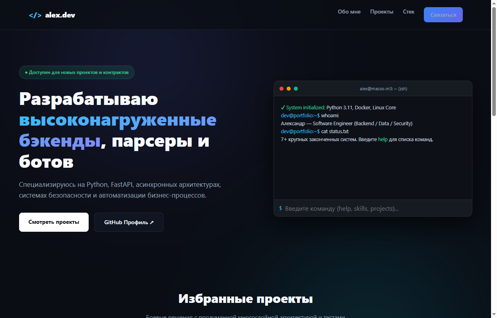
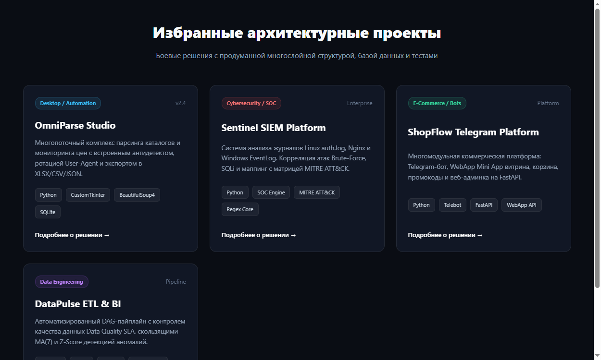
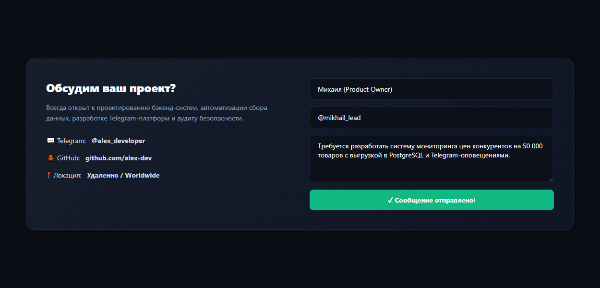

# Minimalist Developer Portfolio & Terminal Showcase

Премиальный персональный сайт-портфолио и интерактивная визитка для Software Engineer / Fullstack разработчика.

Выполнен в эстетике **Dark Glassmorphism / Vercel & Apple Developer Style**: глубокий графитовый фон `#0A0D14`, рассеянные неоновые градиенты, интерактивный консольный терминал, карточки ключевых проектов со стек-тегами и форма обратной связи.

---

## Галерея экранов

### 1. Главный экран (Hero Section & Interactive Terminal)
Интерактивный терминал в реальном времени реагирует на команды (`help`, `skills`, `projects`, `contact`, `clear`), выводя стек технологий и статус инженера.


### 2. Витрина ключевых решений (Featured Projects)
Сетка архитектурных проектов с бейджами категорий, кратким описанием, стек-тегами и модальными переходами.


### 3. Контактный блок & Обратная связь
Двухколоночный блок с прямыми ссылками на социальные сети (Telegram, GitHub) и валидируемой формой отправки технического задания.


---

## Стек технологий
- **Фронтенд:** HTML5, CSS3 (Glassmorphism, Flexbox, Grid), Vanilla JavaScript (Terminal command parser).
- **Бэкенд:** Python 3 (локальный легковесный HTTP-сервер без тяжелых зависимостей).
- **Данные:** `data/projects.json` — конфигурация витрины проектов.

---

## Быстрый запуск

1. Клонируйте репозиторий:
   ```bash
   git clone https://github.com/username/dev-portfolio-minimal.git
   cd dev-portfolio-minimal
   ```

2. Запустите локальный сервер:
   ```bash
   python server.py
   ```
   Сайт автоматически откроется в браузере по адресу `http://localhost:3000`.
